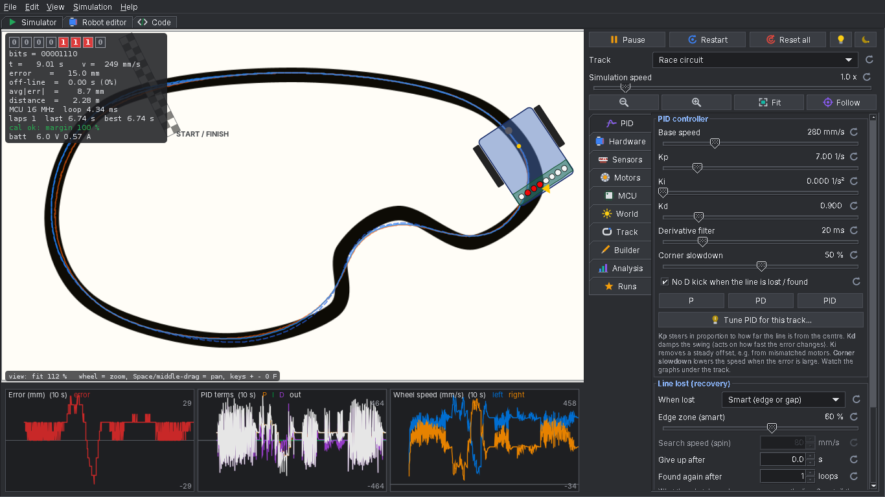
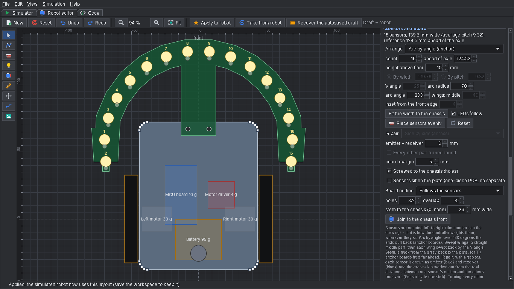
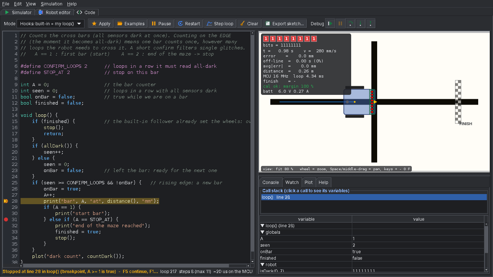
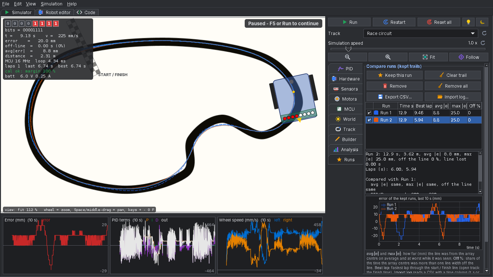

# LineFollowerSim

**Design, tune and program a line-follower robot on your PC, then build the real one.**

LineFollowerSim simulates the whole robot in real units: the chassis, the sensor board and its
optics, the motors, wheels and battery, the microcontroller's loop timing, and the PID and
recovery code. You can draw your robot, write its program in Arduino-style C, step through it with a
debugger, and export a matching Arduino sketch and DXF drawings to build it.

Java 8 + Swing, no external libraries. Runs on Windows, Linux and macOS.



---

## Features

**Realistic simulation**
- Up to 32 sensors in any layout: straight, V, arc, anchor and swept-wing boards, or placed one by one.
- Sensor optics: spot size, height (also per sensor), real sensor parts (TCRT5000, QRE1113 ...),
  crosstalk from the real emitter / receiver geometry, ambient light, flicker, white LEDs, noise,
  mismatch, calibration and its drift.
- MCU timing: compute time per board (Uno ... ESP32, RP2040), loop delay or fixed period, jitter.
  A slow loop hurts the robot here the same way it does on the board.
- Drive: 2 wheels + caster, 4-wheel skid steer, or car steering (servo or DC). Motor lag, dead
  zone and mismatch, or a physical motor model. Grip, encoders with a speed loop, battery sag
  and capacity, tipping in fast bends.
- Real-world effects: board lift, shiny tape, dust, motor warm-up, stuck sensors, brown-outs.

**Robot editor**
- A full-window drawing tool for the chassis, the sensor board, LEDs, parts and wheels.
- Tools: snapping, symmetry, align / distribute, measuring, and undo.
- Trace a photo of your robot (auto-trace) or import a DXF / SVG outline.
- Gives weight and centre of mass, and warns about wheels hitting the chassis and tipping.



**Code tab with a debugger**
- Write the robot's program in plain Arduino-style C. Let the built-in follower drive and add
  your own logic (Hooks mode), or write the whole controller yourself (Full code mode).
- The sliders are live constants in the code (`KP`, `BASE_SPEED`, `THRESHOLD` ...).
- Breakpoints (also with conditions), step over / into / out, call stack, variables, console and
  plot. While the code is stopped, the whole simulation freezes at that moment.
- Examples: marker counter / maze end, PID written out, bang-bang, timed junction turn ...



**Tune and compare**
- Keep runs and compare their trails, lap times and errors, and see which settings differ.
- Automatic PID tuning for a track, a robot designer, and a design check.
- Draw your own tracks with the track builder. Print a track at real size.



**From the simulator to the real robot**
- **Arduino sketch export.** The sketch runs the same controller with the same gains, plus your
  Code-tab program. This was checked by replaying the simulator's sensor readings through the
  generated C++: the wheel commands match.
- **DXF / SVG drawings** of the robot (1:1, layered) and the track, plus a parts list.
- **Serial log import** to compare a real run with the simulated ones.

---

## Getting started

Requirements: JDK 8 or newer.

**NetBeans:** open the project folder and press **Run** (main class `linefollowersim.LineFollowerSim`).

**Command line** (after *Clean and Build* in NetBeans, or `ant jar`):

```
java -jar dist/LineFollowerSim.jar
```

The window is made for 1366 x 768 and larger. Dark theme by default (light theme on the top bar).

## Quick start

1. Pick a **Track** in the top bar and press **Run** (F5).
2. Change **Kp / Kd** on the PID tab and watch the error graph.
3. **Keep this run** (Ctrl+K), change something, **Restart** (F6), and compare on the **Runs** tab.
4. Draw your own robot on the **Robot editor** tab and press **Apply to robot**.
5. On the **Code** tab, open **Examples > Marker counter**, set a breakpoint and run it.
6. **File > Export Arduino sketch** (Ctrl+E) when it works.

A taste of the Code tab (Hooks mode: the built-in follower drives, this adds a cross-bar counter):

```c
int A = 0;          // bars seen
int seen = 0;       // loops in a row with every sensor dark
bool onBar = false;

void loop() {
    if (allDark()) seen++; else { seen = 0; onBar = false; }
    if (seen >= 2 && !onBar) {      // a new bar: count it once
        onBar = true;
        A++;
        print("bar", A);
    }
    if (A == 2) stop();             // end of the maze
}
```

## Documentation

- **[MANUAL.md](MANUAL.md)**: the full guide (every tab, the Robot editor, the Code tab, exports,
  tests, things to know).
- **[OPTIONS-REFERENCE.txt](OPTIONS-REFERENCE.txt)**: every setting with its default, range and
  what it does.
- Press **F1** in the program for the keyboard shortcuts.

## Tests

`test/linefollowersim/SelfTest.java` (right-click > Run File in NetBeans) runs 131 checks on the
physics, sensors, controller, robot editor, code interpreter and exports.

## License

[MIT](LICENSE)
